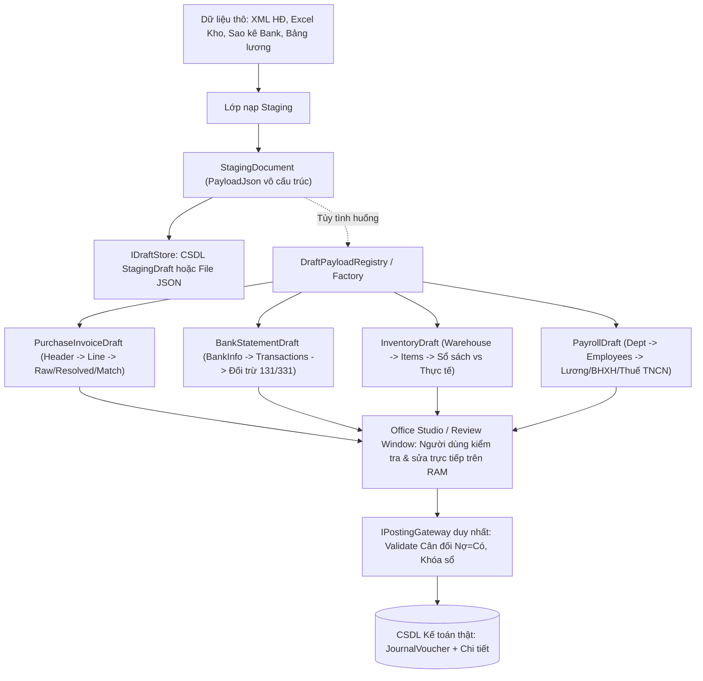

# KIẾN TRÚC LỚP ĐỆM STAGING & CƠ CHẾ DTO PHÂN CẤP ĐỘNG
*Tài liệu kỹ thuật giải pháp Schema-less Document Store & Dynamic Hierarchical DTOs*

---

## 1. BẢN CHẤT VẤN ĐỀ: SỰ BIẾN ĐỘNG CỦA DỮ LIỆU ĐẦU VÀO
Trong kế toán doanh nghiệp, dữ liệu nháp đổ về hệ thống từ nhiều nguồn rất phân mảnh và biến động:
1. **Hóa đơn điện tử (XML từ Cổng Thuế TCT):** Hóa đơn bán lẻ, dịch vụ, thương mại, sản xuất, xăng dầu, viễn thông có chỉ số kỳ cước...
2. **Sao kê ngân hàng (Bank Statements):** Định dạng khác nhau giữa Vietcombank, BIDV, Techcombank, VPBank... (Cột Ghi nợ, Ghi có, Số dư, Diễn giải nội dung, Mã GD).
3. **Bảng kê kho & Kiểm kê (Excel):** Mã kho, tên vật tư, quy cách lô/hạn, số lượng sổ sách, số lượng thực tế, nguyên nhân thừa thiếu.
4. **Bảng lương & Trích bảo hiểm (Excel):** Hàng chục cột phụ cấp, ngày công, bảo hiểm bắt buộc (3383, 3384, 3386), thuế TNCN (3335), lương thực lĩnh (334).
5. **Dữ liệu do AI / OCR trích xuất:** Chứa các đề xuất suy luận, độ tự tin (Confidence), lý do đối chiếu.

> [!IMPORTANT]
> **Không thể và không nên gò ép các dữ liệu này thành các cột cố định trong CSDL quan hệ!**  
> Việc tạo các bảng quan hệ cứng nhắc sẽ dẫn đến:
> - Schema liên tục vỡ khi nhà nước đổi chuẩn hóa đơn hoặc doanh nghiệp đổi mẫu biểu Excel.
> - CSDL phình to với vô số cột `NULL` hoặc quan hệ thừa thãi.
> - Người dùng bị bó buộc, không thể đưa dữ liệu đa ngành nghề vào phân tích.

---

## 2. GIẢI PHÁP: DOCUMENT STORE TRONG LÒNG RDBMS (SCHEMA-LESS STAGING)

### 2.1. Vỏ bọc lưu trữ vật lý tối giản (`StagingDraft` / `StagingDocument`)
Hệ thống lưu trữ ở tầng Staging (cả ở chế độ CSDL tập trung MSSQL/PostgreSQL/Access lẫn chế độ Tệp JSON cục bộ) chỉ duy trì **1 bảng duy nhất** với cấu trúc Document Store:

```sql
CREATE TABLE [dbo].[StagingDraft](
    [DraftId]         NVARCHAR(64) NOT NULL PRIMARY KEY, -- Mã định danh duy nhất (UUID)
    [DraftType]       NVARCHAR(50) NOT NULL,             -- Phân hệ nghiệp vụ (PurchaseInvoice, BankStatement, InventoryMovement, Payroll...)
    [Status]          NVARCHAR(50) NOT NULL,             -- Trạng thái: Imported, Matched, NeedsReview, Approved, Posted, Rejected
    [SourceKind]      NVARCHAR(50) NULL,                 -- Nguồn: TaxInvoice, Excel, BankXml, Ocr, AiChat...
    [SourceRef]       NVARCHAR(255) NULL,                -- Số HĐ, tên file, số tham chiếu
    [PayloadJson]     NVARCHAR(MAX) NOT NULL,            -- Toàn bộ cây dữ liệu phân cấp dạng JSON
    [CreatedAt]       DATETIME NOT NULL,                 -- Thời điểm nạp
    [UpdatedAt]       DATETIME NOT NULL,                 -- Thời điểm cập nhật cuối
    [PostedVoucherId] INT NULL                           -- ID chứng từ kế toán thật sau khi đã ghi sổ
);
```

### 2.2. Ưu điểm vượt trội của giải pháp:
- **Linh hoạt tuyệt đối:** Dữ liệu có thể có 5 trường hay 50 trường, phẳng hay phân cấp 5 tầng đều nằm trọn vẹn trong `PayloadJson`.
- **Độc lập và an toàn:** Dữ liệu nháp dù sai lệch, thiếu tài khoản, mất cân đối cũng không bao giờ làm vỡ ràng buộc (Foreign Key / Constraints) của CSDL kế toán thật.
- **Dễ dàng đồng bộ 2 chiều (JSON ⇄ DB):** Mỗi bản ghi tương đương 1 tệp JSON `Draft_{DraftId}.json`, công cụ `DraftMigrationService` có thể quét và chuyển dịch 2 chiều với hiệu năng cực cao.

---

## 3. CƠ CHẾ SINH DTO PHÂN CẤP TÙY THEO TÌNH HUỐNG (DYNAMIC HIERARCHICAL DTOS)

Khi dữ liệu nằm trong Staging, nó là một chuỗi JSON linh hoạt (`StagingDocument`).  
**Nhưng khi đưa vào một tình huống nghiệp vụ cụ thể**, hệ thống sẽ sinh ra **Cây DTO phân cấp tương ứng** để hiển thị, tính toán, kiểm tra và cho người dùng thao tác.



### 3.1. Các DTO phân cấp chuyên biệt (`NewaccNet.Contracts`):

1. **`VoucherDraft` (Hóa đơn mua vào / Bán ra / Phiếu thu / chi):**
   - Phân cấp 3 tầng: `Header` ➔ `Lines` ➔ `(Raw, Resolved, Match)`.
   - Lưu vết đối chiếu: Khớp MST (`TaxCodeExact`), Khớp bí danh (`AliasMemory`), Khớp luật (`PostingRule`), Gợi ý AI (`Ai`).
2. **`BankStatementDraft` (Sao kê ngân hàng):**
   - Phân cấp: `BankInfo` (TK, Ngân hàng, Số dư đầu/cuối) ➔ `Transactions` (Ngày, Số tiền Thu/Chi, Diễn giải, Gợi ý TK Nợ/Có, Đối tác).
3. **`InventoryDraft` (Kiểm kê / Nhập xuất kho từ Excel):**
   - Phân cấp: `Warehouse` ➔ `Items` (Mã, Tên, ĐVT, Lô/Hạn, SL sổ sách, SL thực tế, Chênh lệch `DiffQuantity`, Tài khoản kho/giá vốn).
4. **`PayrollDraft` (Bảng lương & Trích bảo hiểm):**
   - Phân cấp: `Period` (Tháng/Năm, Phòng ban) ➔ `Employees` (Lương cơ bản, Phụ cấp, Trích BHXH 338, Thuế TNCN 3335, Phải trả 334).

### 3.2. Cơ chế chuyển đổi 2 chiều đơn giản:
```csharp
// 1. Đóng gói DTO phân cấp vào StagingDocument
var doc = StagingDocument.FromPayload("DRAFT_001", "BankStatement", bankDraft);
await store.SaveDocumentAsync(doc);

// 2. Tùy tình huống nghiệp vụ: Lấy tài liệu ra và chuyển sang DTO tương ứng
var doc = await store.GetDocumentAsync("DRAFT_001");
var bankDraft = doc.As<BankStatementDraft>();

// Hoặc phân giải tự động đa hình qua Registry
var payload = DraftPayloadRegistry.Deserialize(doc.DraftType, doc.PayloadJson);
```

---

## 4. TÍCH HỢP VỚI OFFICE STUDIO & POSTING GATEWAY
1. **Zero-Disk I/O trên Excel:** Chuỗi `PayloadJson` được nhúng ẩn an toàn vào thẻ `CustomXmlPart` của tệp Excel OpenXML thông qua `DraftWorkbookPackage`. Người dùng nhìn thấy giao diện bảng tính trực quan, sửa số liệu trên Excel thì JSON ngầm được cập nhật theo.
2. **Human-in-the-loop:** Người dùng là người duyệt cuối cùng trên màn hình Office Studio.
3. **Cổng ghi sổ duy nhất `IPostingGateway`:** Khi bấm Duyệt & Ghi sổ:
   - DTO phân cấp đi qua `IDraftVoucherBuilder` để chuyển thành `JournalVoucherEntity`.
   - `IVoucherValidator` thẩm định điều kiện cân đối Nợ = Có và kỳ khóa sổ.
   - `IPostingGateway` mở Transaction ghi vào bảng thật và cập nhật `PostedVoucherId` trở lại `StagingDraft`.
