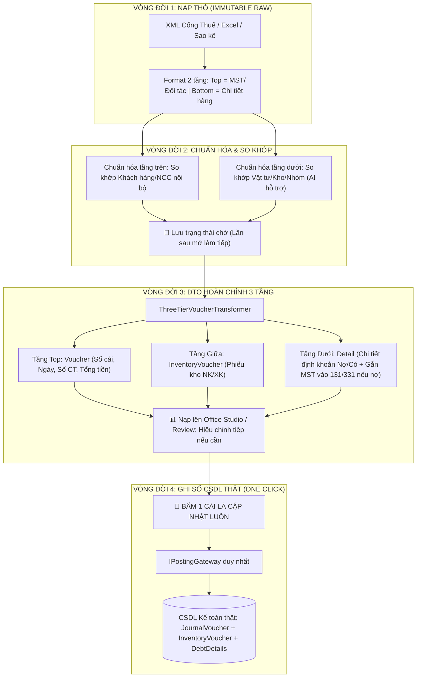

# KIẾN TRÚC LỚP ĐỆM STAGING: TÍNH BẤT BIẾN, VÒNG ĐỜI VÀ MÔ HÌNH DTO 3 TẦNG
*Tài liệu kỹ thuật định hướng giải pháp Schema-less Document Store & Dynamic Lifecycle Stages*

---

## 1. TRIẾT LÝ THIẾT KẾ CỐT LÕI (BẤT BIẾN & VÒNG ĐỜI)
1. **Stagedata là bất biến (Immutable Raw):** Dữ liệu gốc khi lấy về từ nguồn ngoài (XML hóa đơn Cổng thuế, file Excel thô, sao kê ngân hàng) được giữ nguyên vẹn 100%, không bị sửa đổi hay ghi đè làm mất dấu vết pháp lý.
2. **Dữ liệu có vòng đời (Lifecycle Stages):** Stagedata không đứng yên mà chuyển hóa từng bước qua các vòng đời.
3. **Lưu trạng thái chờ (Persistent Checkpoints):** Ở bất kỳ vòng đời nào, người dùng có thể lưu lại dạng chờ để hôm sau mở lên làm việc tiếp từ đúng điểm dừng đó.
4. **Luôn cho phép hiệu chỉnh ở vòng cuối (Human-in-the-loop):** Vòng 3 (mức DTO hoàn chỉnh) vẫn được nạp lên giao diện (Office Studio / Review Grid) để người dùng kiểm tra hoặc sửa tay lần cuối trước khi bấm nút.
5. **"Bấm một cái là cập nhật luôn":** Khi đã duyệt vòng 3, người dùng chỉ cần nhấn 1 nút ➔ Cổng ghi sổ duy nhất `IPostingGateway` lập tức hạch toán và mở Transaction ghi vào CSDL thật.

---

## 2. CÁC ĐỊNH DẠNG TẦNG CỦA STAGING (1 TẦNG, 2 TẦNG, 3 TẦNG)

Dữ liệu nạp vào Staging tùy theo bài toán sẽ có format khác nhau:

### 2.1. Định dạng 1 tầng — Danh mục độc lập (`MasterDataDraft`)
- **Tình huống:** Chỉ cần đồng bộ hoặc bổ sung danh mục Đối tác (Khách hàng / NCC), Hàng hóa / Vật tư, Nhóm hàng từ file Excel hoặc từ hóa đơn.
- **Quy trình:**
  - Hệ thống lấy danh sách mã/tên/MST từ nguồn ngoài.
  - So khớp với DB nội bộ xem đã tồn tại chưa (`ExistsInDb`).
  - Với các bản ghi mới hoặc gần giống: **AI trợ giúp gợi ý** (Gợi ý mã chuẩn, nhóm vật tư, tài khoản mặc định, độ tự tin `Confidence`, lý do `Reason`).
  - Người dùng tick duyệt ➔ Đẩy vào DB danh mục thật qua `IMasterDataGateway`.

### 2.2. Định dạng 2 tầng — Hóa đơn gốc vừa nạp (Vòng đời 1)
- **Tình huống:** Khi tải hóa đơn XML từ Cổng Thuế về, được lưu trữ theo thư mục phân cấp JSON hoặc bảng CSDL `StagingDraft`.
- **Cấu trúc 2 tầng:**
  - **Tầng trên (Header):** Mã số thuế, tên người bán/người mua, địa chỉ, mẫu số, ký hiệu, số hóa đơn, ngày lập.
  - **Tầng dưới (Lines):** Chi tiết các dòng hàng thô (Tên hàng gốc, ĐVT gốc, Số lượng, Đơn giá, Thành tiền, Thuế suất).

### 2.3. Vòng đời 2 — Chuẩn hóa & So khớp danh mục (Master Data Resolution)
- **Tầng trên (Giao diện):** Chuẩn hóa thông tin đối tác & so khớp với danh mục Khách hàng/NCC trong DB (`RawTaxCode` ➔ `ResolvedPartnerId`).
- **Tầng dưới (Giao diện):** Chuẩn hóa danh mục hàng hóa, vật tư, nhóm, kho nội bộ (`RawItemName` ➔ `ResolvedMaterialId`, `WarehouseId`, `DebitAccountId`).
- **AI trợ giúp:** Áp dụng bộ lọc 3 nấc: Khớp MST tất định ➔ Khớp Sổ tay ghi nhớ (`AliasMemory`) ➔ Trợ lý AI gợi ý cho các mã chưa từng gặp.
- Dữ liệu ở Vòng đời 2 có thể **lưu nháp ở dạng chờ** để người dùng nghỉ tay, lần sau làm tiếp.

### 2.4. Vòng đời 3 — Chuẩn hóa mức DTO hạch toán (Cấu trúc 3 tầng: Voucher ➔ InventoryVoucher ➔ Detail)
Khi danh mục đã thông, hệ thống nâng cấp dữ liệu lên **Cấu trúc 3 tầng (`AccountingVoucherThreeTierDraft`)**:
- **Tầng Top (Tầng 1 - Voucher):** Chứng từ sổ cái (Journal Voucher) gồm Số chứng từ, Ngày hạch toán, Diễn giải, Tổng tiền hàng, Tiền thuế, Tổng thanh toán, Tài khoản thanh toán (3311, 111, 112).
- **Tầng Giữa (Tầng 2 - InventoryVoucher):** Phiếu kho (nếu có hàng hóa/vật tư qua kho): Mã kho, Loại phiếu (Nhập kho `NK` / Xuất kho `XK`), Người giao nhận, Ngày nhập.
- **Tầng Dưới (Tầng 3 - Detail):** Chi tiết từng dòng định khoản (Nợ TK Kho/Chi phí, Có TK Thanh toán, Tiền thuế GTGT).
  > [!NOTE]
  > **Quy tắc công nợ:** *Nếu là giao dịch công nợ (có TK 131/331), hệ thống mới lấy thông tin Mã số thuế & Mã đối tác đưa vào chi tiết để theo dõi sổ công nợ chi tiết theo từng đối tượng.*

---

## 3. SƠ ĐỒ VÒNG ĐỜI DỮ LIỆU TOÀN CẢNH



---

## 4. TỔ CHỨC LƯU TRỮ VẬT LÝ TRONG STAGING
Dù dữ liệu ở Vòng đời 1 (2 tầng), Vòng đời 2 (đang map dở), hay Vòng đời 3 (3 tầng hoàn chỉnh), ở tầng lưu trữ vật lý (CSDL bảng `StagingDraft` hoặc File JSON `Draft_{DraftId}.json`) đều lưu dưới dạng:

```sql
CREATE TABLE [dbo].[StagingDraft](
    [DraftId]         NVARCHAR(64) NOT NULL PRIMARY KEY,
    [DraftType]       NVARCHAR(50) NOT NULL, -- MasterData, PurchaseInvoice, AccountingVoucher3Tier...
    [Status]          NVARCHAR(50) NOT NULL, -- Imported, Matched, NeedsReview, Approved, Posted
    [SourceKind]      NVARCHAR(50) NULL,
    [SourceRef]       NVARCHAR(255) NULL,
    [PayloadJson]     NVARCHAR(MAX) NOT NULL, -- Toàn bộ cây 1 tầng / 2 tầng / 3 tầng
    [CreatedAt]       DATETIME NOT NULL,
    [UpdatedAt]       DATETIME NOT NULL,
    [PostedVoucherId] INT NULL
);
```

Mỗi lần kế toán dừng tay nghỉ, hệ thống serialize DTO hiện tại vào `PayloadJson` và lưu lại. Khi mở phần mềm lên, hệ thống deserialize ra đúng tầng của vòng đời đó để tiếp tục làm việc mà không làm mất bất kỳ thông tin nào!

