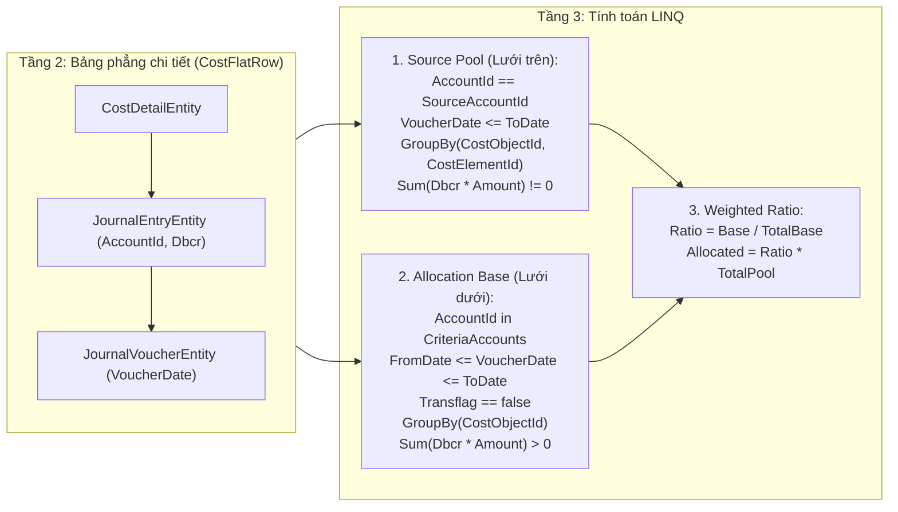

# Kiến Trúc & Nghiệp Vụ Module Phân Bổ Chi Phí (`CostAllocation`)

Tài liệu này mô tả chi tiết bản chất kế toán, cấu trúc dữ liệu phẳng 3 tầng (theo chuẩn [FlatTableRules.md](file:///d:/NewaccNet/.ai_context/FlatTableRules.md)), vai trò của cờ `TransFlag`, và thiết kế kiến trúc phân mảnh ("Mảnh ghép") của phân hệ **Phân bổ chi phí (`CostAllocation`)** trong hệ thống NewaccNet.

---

## 1. Bản Chất Nghiệp Vụ Kế Toán (Accounting-First Philosophy)

Trong kế toán xây lắp và sản xuất (ví dụ: TK `1541`, `627`...), có những khoản chi phí phát sinh dùng chung cho nhiều công trình/sản phẩm (như chi phí máy thi công, khấu hao máy móc, chi phí quản lý chung...) hoặc đang tập hợp ở một tài khoản nguồn cần phân bổ về các **Đối tượng tập hợp chi phí (`CostObject`)** cụ thể theo một tiêu thức hợp lý.

Quá trình **Phân bổ chi phí** gồm 3 thành phần toán học và kế toán:

1. **Tử số chung (`TotalPoolAmount` — Lưới trên: Chi phí nguồn cần phân bổ)**:
   - Là **số dư chi phí còn lại** (`Σ(Dbcr × Amount)`) của **Tài khoản nguồn (`SourceAccountId`)** tính đến ngày cuối kỳ (`ToDate`).
   - Gom nhóm theo cặp `(CostObjectId, CostElementId)` để người dùng kiểm soát rõ nguồn tiền chờ phân bổ gồm những đối tượng, yếu tố chi phí nào.
   - Tổng cộng các dòng trên lưới trên là `TotalPoolAmount` (con số màu đỏ `Tổng số`).

2. **Mẫu số phân bổ (`TotalBaseAmount` — Lưới dưới: Tiêu thức phân bổ)**:
   - Người dùng chọn một danh sách các **Tài khoản tiêu thức** (`AllocationBaseAccountIds`, tương đương bảng `[Temp Account List]` trong Access, ví dụ: `1541, 1542, 1543, 621, 622...`).
   - Hệ thống tập hợp **chi phí phát sinh gốc trong kỳ** (`FromDate .. ToDate`) của các tài khoản tiêu thức này, gom nhóm theo từng **Đối tượng chi phí (`CostObjectId`)**.
   - Mỗi đối tượng có số tiền tiêu thức `BaseAmount`. Tổng tiêu thức của tất cả các đối tượng là `TotalBaseAmount = Σ(BaseAmount)`.

3. **Tính tỷ trọng bình quân gia quyền & Sinh chứng từ kế toán**:
   - **Tỷ trọng (`%`) của từng đối tượng**:
     $$\text{RatioPercent}_i = \frac{\text{BaseAmount}_i}{\text{TotalBaseAmount}}$$
   - **Số tiền phân bổ cho từng đối tượng**:
     $$\text{AllocatedAmount}_i = \text{Round}\left(\text{RatioPercent}_i \times \text{TotalPoolAmount}, 0\right)$$
     *(Phần chênh lệch làm tròn đồng lẻ được điều chỉnh vào dòng có giá trị phân bổ lớn nhất để đảm bảo $\sum \text{AllocatedAmount}_i = \text{TotalPoolAmount}$ tuyệt đối).*
   - **Sinh 1 Chứng từ kế toán (`JournalVoucher`) duy nhất**:
     - **Bút toán 1 — Ghi Có TK Nguồn (`Dbcr = -1`, `AccountId = SourceAccountId`, `Amount = TotalPoolAmount`)**:
       - Gồm các dòng `CostDetail` đối ứng chính xác 1-1 với từng dòng trên Lưới trên (`SourcePoolItems`), mang cờ `Transflag = true`.
       - Khi ghi Có, tổng số dư `Σ(Dbcr × Amount)` của Tài khoản nguồn sẽ tự động triệt tiêu về `0`.
     - **Bút toán 2 — Ghi Nợ TK Đích (`Dbcr = 1`, `AccountId = DestinationAccountId`, `Amount = TotalPoolAmount`, `ParentEntry = creditEntry`)**:
       - Gồm các dòng `CostDetail` cho từng đối tượng ở Lưới dưới (`CriteriaItems`), gắn với `CostObjectId` của đối tượng đó và `CostElementId = DestinationCostElementId` (Yếu tố đích), mang cờ `Transflag = false`.

---

## 2. Giải Nghĩa Chính Xác Vai Trò Của Cờ `TransFlag` (`CostDetail.Transflag`)

Đây là điểm rất quan trọng cần nắm rõ khi đọc code kế thừa từ Access (`vba-reference.cls` và `query.txt`):

| Vị trí | Quy tắc với `TransFlag` | Giải thích bản chất |
| :--- | :--- | :--- |
| **1. Tính số dư chi phí nguồn (Lưới trên & Kết chuyển chi phí)** | **KHÔNG lọc `TransFlag`** | Số dư tài khoản chi phí được tính thuần túy theo nguyên lý kế toán: `Rest = Σ(Dbcr × Amount)` (Nợ `+1`, Có `-1`). Khi phân bổ/kết chuyển xong, dòng Ghi Có (`Dbcr = -1`) sẽ bù trừ trực tiếp với dòng Ghi Nợ (`Dbcr = +1`) làm số dư tự động bằng `0`. Nếu lọc `Transflag == false` ở bước này sẽ bỏ sót bút toán Ghi Có giảm trừ, khiến chi phí nguồn không bao giờ giảm về `0`! |
| **2. Tính tiêu thức phân bổ (Lưới dưới)** | **Lọc `Transflag == false`** | Tiêu thức phân bổ cần lấy **số phát sinh chi phí gốc trong kỳ** của từng công trình/đối tượng. Nếu tài khoản tiêu thức (ví dụ `621`, `1541`) đã được kết chuyển trong kỳ (sinh dòng Ghi Có có `Transflag = true`), việc lọc `Transflag == false` giúp giữ lại số phát sinh gốc để chia tỷ lệ thay vì bị dòng kết chuyển trừ về `0`. |
| **3. Khi sinh chứng từ Phân bổ — Dòng Ghi Có (TK Nguồn)** | **Gán `Transflag = true`** | Đánh dấu đây là dòng giảm trừ do hệ thống tự động kết chuyển/phân bổ sinh ra (phục vụ tra cứu *Xem lại* và loại trừ khỏi tiêu thức phát sinh gốc ở mục 2). |
| **4. Khi sinh chứng từ Phân bổ — Dòng Ghi Nợ (TK Đích)** | **Gán `Transflag = false`** | Chi phí sau khi phân bổ sang Tài khoản đích (gắn với công trình cụ thể) là chi phí thực tế của công trình đó, cần được tiếp tục theo dõi số dư và kết chuyển sang giá vốn (`632`) khi nghiệm thu. |

---

## 3. Quy Tắc Bảng Phẳng 3 Tầng (Áp Dụng `FlatTableRules.md`)

Không sử dụng SQL View hay Stored Procedure. Toàn bộ dữ liệu đi qua cấu trúc phẳng trong bộ nhớ:

---

## 4. Kiến Trúc Phân Mảnh ("Mảnh Ghép") Trong `NewaccNet.Wpf/AppSystem/CostAllocation/`

Để code dễ đọc, dễ bảo trì và mỗi bước chỉ làm đúng một việc, module được tách thành các mảnh ghép độc lập:

| File | Vai trò ("Mảnh ghép") |
| :--- | :--- |
| `CostAllocationDtos.cs` | Chứa các DTO dữ liệu phẳng (`CostFlatRow`), dòng chi phí nguồn (`CostSourceItemDto`), dòng tiêu thức & kết quả phân bổ (`CostCriteriaItemDto`), tham số (`CostAllocationParams`) và kết quả tổng hợp (`CostAllocationCalculationResult`). |
| `CostAllocationSnapshotLoader.cs` | **Mảnh ghép 1 & 2 (Dựng bảng phẳng & Lọc dữ liệu)**: Nạp `CostDetail -> JournalEntry -> JournalVoucher`, làm phẳng thành `CostFlatRow`, lọc Lưới trên (`LoadSourcePool`) và lọc Lưới dưới (`LoadCriteriaBase`). |
| `CostAllocationCalculator.cs` | **Mảnh ghép 3 (Tính tỷ lệ & Phân bổ)**: Thực hiện phép chia tỷ trọng bình quân gia quyền `RatioPercent = BaseAmount / TotalBaseAmount`, tính `AllocatedAmount = Round(RatioPercent * TotalPoolAmount)` và xử lý làm tròn đồng lẻ. |
| `CostAllocationVoucherBuilder.cs` | **Mảnh ghép 4 (Sinh chứng từ kế toán)**: Tạo `JournalVoucher`, 1 `JournalEntry` Ghi Có (`SourceAccountId`, `Transflag = true`) và 1 `JournalEntry` Ghi Nợ (`DestinationAccountId`, `Transflag = false`), lưu transaction. |
| `CostAllocationService.cs` | **Nhạc trưởng (Orchestrator)**: Điều phối `SnapshotLoader` $\rightarrow$ `Calculator` $\rightarrow$ `VoucherBuilder`. |
| `CostAllocationWindow.xaml(.cs)` | **Giao diện (UI & Rule Persistence)**: Sử dụng chuẩn `AppDateEdit`, `AppDetailTableView`, `LookUpEdit` 2 cột (`SearchLookUpBehavior`), lưu/nạp bộ quy tắc phân bổ theo từng Tài khoản nguồn qua `UserPreferencesHelper`. |
