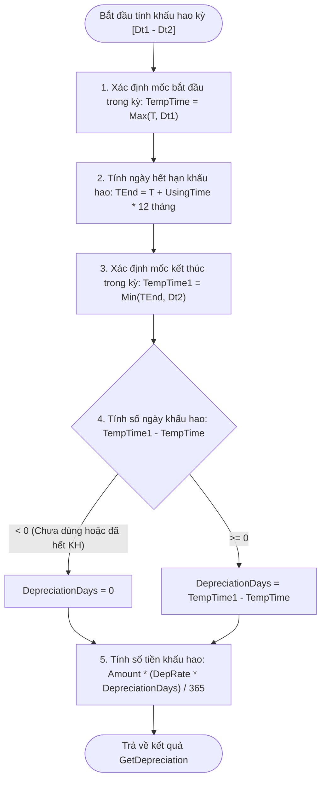

# Thiết Kế & Kế Hoạch Module Khấu Hao Tài Sản Cố Định (Fixed Assets Depreciation)

Tài liệu này được lập để thảo luận và chuẩn bị chuyển dịch vụ/nghiệp vụ sang module **Quản lý & Trích Khấu hao Tài sản Cố định (TSCĐ)** trong hệ thống NewaccNet.

---

## 1. Giải Nghĩa Hàm Tính Khấu Hao VBA (`GetDepreciation`)

```vba
Function GetDepreciation(Dt1 As Variant, Dt2 As Variant, T As Variant, UsingTime As Double, DepRate As Double, Amount As Double)
 Dim TempTime As Variant
 Dim TempTime1 As Variant
 Dim DepreciatioRatio As Double
 Dim DepreciationDays As Integer
 TempTime = IIf(T > Dt1, T, Dt1)

 TempTime1 = IIf(DateAdd("m", UsingTime * 12, T) < Dt2, DateAdd("m", UsingTime * 12, T), Dt2)

 DepreciationDays = IIf(DateDiff("d", TempTime, TempTime1) < 0, 0, DateDiff("d", TempTime, TempTime1))

 GetDepreciation = Amount * (DepRate * DepreciationDays) / 365
End Function
```

### 1.1. Các tham số đầu vào (Inputs)
| Tham số | Kiểu dữ liệu | Ý nghĩa nghiệp vụ |
| :--- | :--- | :--- |
| `Dt1` | `Date` | **Từ ngày**: Ngày bắt đầu kỳ tính khấu hao (ví dụ: `01/01/2026`). |
| `Dt2` | `Date` | **Đến ngày**: Ngày kết thúc kỳ tính khấu hao (ví dụ: `31/01/2026` hoặc cuối năm). |
| `T` | `Date` | **Ngày bắt đầu sử dụng**: Ngày đưa tài sản vào sử dụng / bắt đầu trích khấu hao. |
| `UsingTime` | `Double` | **Thời gian sử dụng**: Số năm dự kiến trích khấu hao (ví dụ: `5` năm = 60 tháng). |
| `DepRate` | `Double` | **Tỷ lệ khấu hao năm**: Thường là `1 / UsingTime` (ví dụ: 5 năm -> `0.2` tức 20%/năm). |
| `Amount` | `Double` | **Nguyên giá (Giá trị tính khấu hao)** của tài sản. |

---

### 1.2. Bản chất nghiệp vụ & Logic thực thi từng bước



1. **Xác định mốc bắt đầu trích trong kỳ (`TempTime`)**:
   - Nếu tài sản mới đưa vào dùng trong kỳ này (`T > Dt1`), khấu hao tính từ ngày `T`.
   - Nếu tài sản đã dùng từ trước (`T <= Dt1`), khấu hao tính từ đầu kỳ `Dt1`.
2. **Xác định mốc kết thúc trích trong kỳ (`TempTime1`)**:
   - Tính ngày tài sản trích đủ thời gian: `TEnd = Ngày T + UsingTime * 12 tháng`.
   - Nếu tài sản hết hạn trích khấu hao ngay trong kỳ này (`TEnd < Dt2`), dừng trích tại `TEnd`.
   - Nếu tài sản vẫn còn khấu hao tiếp, trích đến hết ngày cuối kỳ `Dt2`.
3. **Tính số ngày khấu hao thực tế trong kỳ (`DepreciationDays`)**:
   - Lấy `TempTime1 - TempTime`. Nếu âm (chưa đến ngày dùng hoặc đã hết khấu hao từ trước kỳ), số ngày = 0.
4. **Tính số tiền trích khấu hao (`GetDepreciation`)**:
   $$\text{Tiền khấu hao} = \text{Amount} \times \frac{\text{DepRate} \times \text{DepreciationDays}}{365}$$
   - Đây là phương pháp **Khấu hao đường thẳng theo số ngày thực tế** (Daily Straight-Line Depreciation) chuẩn mực theo Thông tư 45/2013/TT-BTC.

---

## 2. Mã C# Tương Đương Được Hiện Đại Hóa & Chuẩn Kế Toán

Trong C# .NET, chúng ta sử dụng kiểu `decimal` thay vì `double` để triệt tiêu sai số dấu phẩy động của số tiền kế toán:

```csharp
public static class DepreciationCalculator
{
    /// <summary>
    /// Tính số tiền trích khấu hao tài sản cố định theo ngày thực tế trong kỳ [fromDate, toDate].
    /// </summary>
    public static decimal CalculateDepreciation(
        DateTime fromDate, 
        DateTime toDate, 
        DateTime assetStartDate, 
        double usingTimeYears, 
        double annualDepRate, 
        decimal originalAmount)
    {
        if (originalAmount <= 0 || usingTimeYears <= 0 || annualDepRate <= 0)
            return 0m;

        // 1. Mốc bắt đầu tính khấu hao hiệu lực trong kỳ
        DateTime effectiveStart = assetStartDate > fromDate ? assetStartDate.Date : fromDate.Date;

        // 2. Ngày hết hạn khấu hao (thêm N tháng từ ngày bắt đầu dùng)
        int totalMonths = (int)Math.Round(usingTimeYears * 12);
        DateTime assetEndDate = assetStartDate.Date.AddMonths(totalMonths);

        // 3. Mốc kết thúc tính khấu hao hiệu lực trong kỳ
        DateTime effectiveEnd = assetEndDate < toDate ? assetEndDate.Date : toDate.Date;

        // 4. Số ngày trích khấu hao thực tế trong kỳ
        int depreciationDays = (effectiveEnd - effectiveStart).Days;
        if (depreciationDays <= 0)
            return 0m;

        // 5. Tính số tiền khấu hao (làm tròn nguyên đồng)
        // Công thức: Amount * (DepRate * Days) / 365
        decimal ratePerDay = (decimal)annualDepRate / 365m;
        decimal depreciationAmount = originalAmount * ratePerDay * depreciationDays;

        return Math.Round(depreciationAmount, 0, MidpointRounding.AwayFromZero);
    }
}
```

---

## 3. Thống Nhất Thiết Kế Tinh Gọn (Lean Scope)

Theo thống nhất cùng người dùng, đối với phần mềm kế toán vừa và nhỏ, module Tài sản cố định tránh ôm đồm phức tạp ("tránh tham"), tập trung vào các chức năng thiết thực và cốt lõi nhất:
1. **Bỏ các tính năng rườm rà (như nút Undo)**:
   - Mỗi lần tính khấu hao chỉ sinh ra **duy nhất 1 chứng từ (`JournalVoucher`)** gồm:
     - 1 dòng Có TK 214 (Hao mòn)
     - N dòng Nợ TK Chi phí (642, 627, 154...) gắn với Đối tượng CP và Yếu tố CP.
   - Khi sinh xong, chỉ cần nút **"Xem chứng từ vừa sinh"** để mở trực tiếp màn hình `VoucherEntryWindow`. Kế toán có thể xem, in phiếu, hoặc xóa tự nhiên nếu làm nhầm.
2. **Cho phép In Bảng kê phân bổ khấu hao**:
   - Tích hợp nút **In (Print)** sử dụng `PrintPreview` của DevExpress GridControl để in bảng kê số liệu phân bổ trước hoặc sau khi hạch toán.
3. **Quy ước tính toán theo ngày thực tế**:
   - Sử dụng `AssetDepreciationHelper.CalculateDepreciation(...)` (mẫu số 365 ngày).
   - Tự động kẹp biên xử lý lệch pha mốc thời gian: mua giữa kỳ, hết hạn giữa kỳ, hoặc nằm ngoài kỳ.

---

## 4. Kế Hoạch Cho Phiên Làm Việc Tiếp Theo

### Nhiệm Vụ 1: Triển Khai Phân Hệ Khấu Hao Tài Sản Cố Định (Asset Depreciation)
1. **DTOs & Service (`IAssetDepreciationService`, `AssetDepreciationService`)**:
   - Dùng LINQ lấy bản ghi `AssetTracking` mới nhất của từng tài sản (thay thế bảng tạm `AssetTrackingDep`).
   - Tính toán `Rest` (giá trị còn lại), `RestQty`, và gọi `AssetDepreciationHelper.CalculateDepreciation(...)`.
   - Sinh 1 `JournalVoucher` duy nhất với đầy đủ định khoản Nợ/Có và các bảng chi tiết `AssetDetail`, `CostDetail`.
2. **Giao diện (`AssetDepreciationWindow.xaml`)**:
   - Dựng form theo mẫu nguyên bản `depreciationCalbulate.png`.
   - Các trường tham số: Từ ngày, Đến ngày, Tài khoản khấu hao (214), Nguồn (`SrCode`), Yếu tố chi phí, Lý do, Nội dung.
   - Lưới chi tiết: Checkbox chọn KH, Mã TS, Tên TS, ĐVT, Nguồn, Số lượng, Giá trị còn lại, Số tiền khấu hao.
   - Các nút: **Tính toán**, **Khấu hao**, **Xem chứng từ**, **In bảng kê**, **Kết thúc**.

### Nhiệm Vụ 2: Triển Khai Phân Hệ Kết Chuyển Chi Phí (Expense Transfer)
- Dựa trên form mẫu `ExpenseTrasfer.png` trong thư mục `expenseDistribution`:
  - Tham số: Đến ngày, Tài khoản nguồn (2211, 621, 622, 627, 154...), Tài khoản đích (154, 911...), Checkbox Kết chuyển doanh thu, Nội dung chứng từ.
  - Lưới chi tiết: Đối tượng chi phí, Yếu tố chi phí, Checkbox KC, Số dư chi phí, Chi phí để lại.
  - Thực hiện kết chuyển chi phí từ tài khoản nguồn sang tài khoản đích theo từng đối tượng/yếu tố chi phí.

