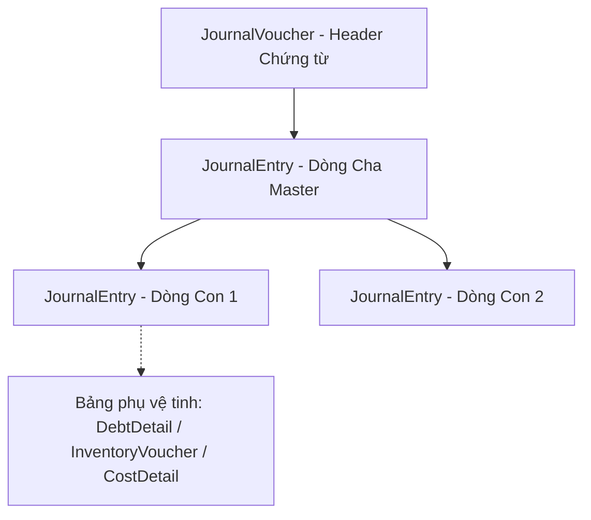
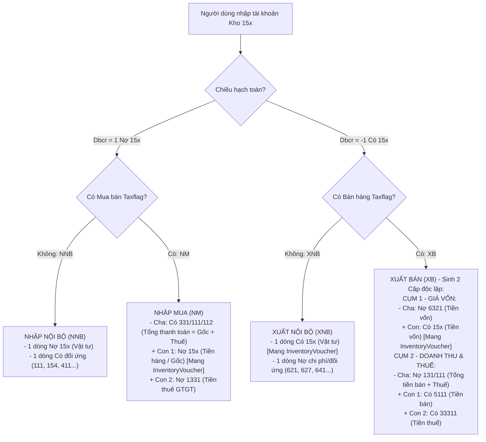
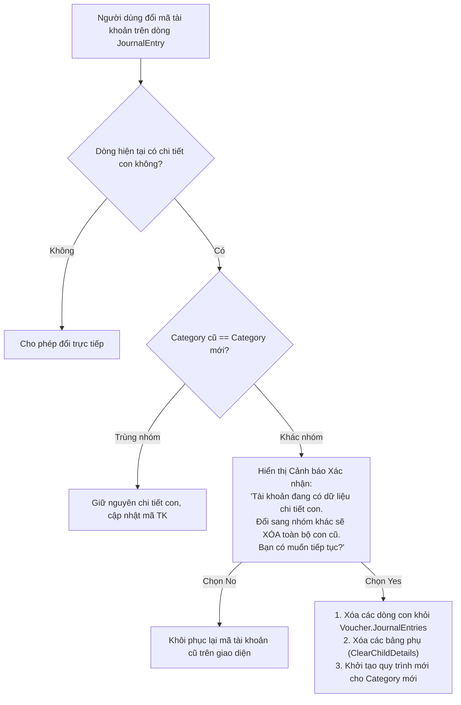

# KIẾN TRÚC & Ý TƯỞNG CỐT LÕI HỆ THỐNG NHẬP CHỨNG TỪ & VẬT TƯ
*(System Architecture & Core Concepts Document)*

---

## 1. TỔNG QUAN NGUYÊN LÝ THIẾT KẾ (Core Philosophy)

Hệ thống được xây dựng trên triết lý **"Kế toán dẫn dắt - Nghiệp vụ chi tiết đi sau" (Accounting-First Domain Driven Design)**:
1. **Trái tim hệ thống**: Mọi hoạt động phát sinh (Thu, Chi, Nhập, Xuất, Mua, Bán, Phân bổ...) đều quy về một cấu trúc hạch toán kế toán kép chuẩn mực.
2. **Database phẳng (Flat DB)**: Dưới cơ sở dữ liệu, toàn bộ bút toán được lưu trữ phẳng trong bảng `JournalEntry` và liên kết cây thông qua `ParentId`.
3. **Giao diện đối ứng (Dual-Grid UI)**: Trên giao diện `VoucherEntryWindow`, dữ liệu phẳng được biểu diễn thành 2 lưới:
   - **Lưới trái (Master)**: Dòng Cha (Đại diện cho 1 chân Nợ hoặc 1 chân Có).
   - **Lưới phải (Detail)**: Các dòng Con (`SubEntries`) đối ứng với dòng Cha.
   - Nguyên tắc: **1 Cha - nhiều Con** (1 Nợ - nhiều Có hoặc 1 Có - nhiều Nợ).



---

## 2. BẢN CHẤT PHÂN HỆ VẬT TƯ (Material Transaction Domain)

Vật tư (`CategoryId = "B"`, các tài khoản đầu `15x`: `152`, `153`, `155`, `156`...) khác biệt hoàn toàn với Công nợ (`A`) hay Chi phí (`E`) vì:
- Vật tư có thể là **Nội bộ** (chỉ dịch chuyển kho) hoặc **Mua bán** (phát sinh hóa đơn, thuế và thanh toán/công nợ).
- Dữ liệu chi tiết lượng - giá nằm ở 2 bảng vệ tinh:
  - `InventoryVoucher`: Header phiếu kho (Kho, Người giao, Số HĐ, Seri, Mã đối tượng thuế...).
  - `InventoryVoucherLine`: Chi tiết từng dòng vật tư (Mã VT, ĐVT, Số lượng, Đơn giá vốn, Thành tiền vốn).
  - `MaterialTaxLine`: Bảng mở rộng 1-1 với dòng vật tư khi có phát sinh Mua bán (Đơn giá bán, % Thuế, Tiền thuế).

---

## 3. PHÂN ĐỊNH 4 LUỒNG NGHIỆP VỤ VẬT TƯ

Hệ thống tự động nhận diện và kiến tạo cây Entity chuẩn xác theo 4 loại chứng từ:



### Chi tiết cấu trúc từng loại:

| Loại phiếu | Ký hiệu | Cụm định khoản | Dòng mang InventoryVoucher | Tài khoản thanh toán / Đối ứng |
| :--- | :---: | :--- | :--- | :--- |
| **Nhập nội bộ** | `NNB` | Nợ `15x` / Có Đối ứng | Dòng Nợ `15x` | Tài khoản đối ứng người dùng nhập |
| **Xuất nội bộ** | `XNB` | Nợ Chi phí / Có `15x` | Dòng Có `15x` | Tài khoản chi phí người dùng nhập |
| **Nhập mua** | `NM` | Cha: Có `331`<br>Con 1: Nợ `15x`<br>Con 2: Nợ `1331` | Dòng Con Nợ `15x` | Dòng Cha Có `331` (Tổng = Hàng + Thuế) |
| **Xuất bán** | `XB` | **Cặp Giá vốn:** Cha Nợ `632` $\rightarrow$ Con Có `15x`<br>**Cặp Bán hàng:** Cha Nợ `131` $\rightarrow$ Con 1 Có `511`, Con 2 Có `3331` | Dòng Con Có `15x` | Cặp 1: Nợ `632`<br>Cặp 2: Nợ `131` |

---

## 4. BẢN CHẤT "TÀI KHOẢN GIÁ VỐN" VS "TÀI KHOẢN VẬT TƯ"

> [!IMPORTANT]
> **Điểm mấu chốt cần tách bạch rõ ràng:**
> 1. **Tài khoản Vật tư (`MaterialEntry`)**:
>    - Là tài khoản thuộc nhóm Kho (`CategoryId = "B"` hoặc mã `15x`, ví dụ: `1521`, `1561`).
>    - Dòng này **luôn luôn là dòng duy nhất sở hữu quan hệ `InventoryVouchers`**.
>    - Trong Xuất bán (`XB`): Dòng này có `Dbcr = -1` (Bên Có), mang giá trị `TotalCostAmount` (Tiền gốc).
> 2. **Tài khoản Giá vốn (`CostMasterEntry`)**:
>    - Là tài khoản chi phí giá vốn (mã `632`, `6321`, hoặc các tài khoản chi phí xuất bán).
>    - Trong Xuất bán (`XB`): Dòng này có `Dbcr = 1` (Bên Nợ), đóng vai trò là **Dòng Cha (Master)** của dòng Vật tư.
>    - **Tuyệt đối không gán Tài khoản Giá vốn vào `MaterialEntry.AccountId`**, và ngược lại không gán Tài khoản Vật tư vào `CostMasterEntry.AccountId`.
> 3. **Trong nghiệp vụ Nhập mua (`NM`)**:
>    - **Không có tài khoản giá vốn 632**. Tiền gốc chính là giá trị nhập kho của Tài khoản Vật tư (`15x`). Dòng đối ứng tổng thanh toán là Có `331`/`111`.

---

## 5. BẢO VỆ DỮ LIỆU KHI ĐỔI TÀI KHOẢN (Category Guard)

Khi người nhập liệu sửa tài khoản trên lưới:



---

## 6. KIẾN TRÚC BẢO VỆ MÃ NGUỒN MỞ RỘNG (Custom Entity Protection)

Để bảo đảm an toàn khi người dùng thiết kế lại schema trong **LLBLGen Pro Designer** và thực hiện **Generate Code**:
- Mọi logic mở rộng (Domain methods, Helper properties, `Custom.cs`) **tuyệt đối không để trong thư mục `dataaccess/`**.
- Toàn bộ được đặt tại thư mục riêng: `d:\NewaccNet\DataAccessCustom\`.
- File cấu hình gốc `d:\NewaccNet\Directory.Build.targets` tự động nhồi các file này vào project `DataAccess.csproj` khi biên dịch:

```xml
<Project>
  <ItemGroup Condition="'$(MSBuildProjectName)' == 'DataAccess'">
    <Compile Include="$(MSBuildThisFileDirectory)DataAccessCustom\**\*.cs" />
  </ItemGroup>
</Project>
```
$\Rightarrow$ Người dùng có thể xóa trắng hoặc gen lại thư mục `dataaccess/` bất kỳ lúc nào mà không sợ mất code mở rộng.

---

## 7. KẾ HOẠCH BÀN GIAO & CÔNG VIỆC TIẾP THEO

1. **Rà soát ánh xạ tài khoản Giá vốn trong `MaterialDetailWindow`**:
   - Đảm bảo combobox `lueCostAccount` luôn chỉ cập nhật vào `CostMasterEntry.AccountId` (mặc định `6321`).
   - Đảm bảo tài khoản trên dòng `MaterialEntry` giữ nguyên đúng là tài khoản vật tư (`152`/`156`...) mà người dùng đã chọn ban đầu.
2. **Kiểm thử chu trình lưu và tải lại chứng từ**:
   - Kiểm tra việc load lại chứng từ `XB` và `NM` đã lưu từ DB lên 2 lưới đối ứng xem các dòng Cha - Con có hiển thị đúng vị trí hay không.
